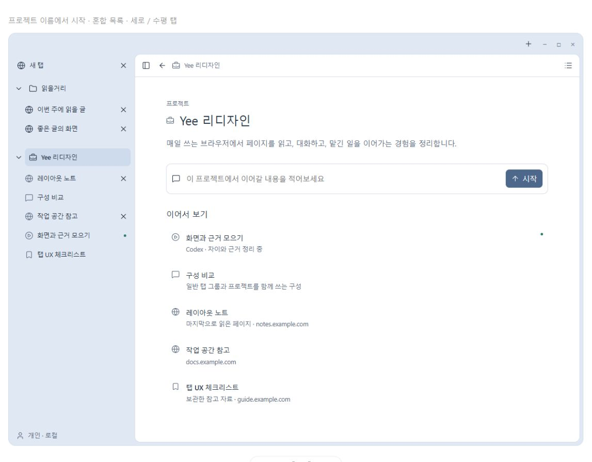
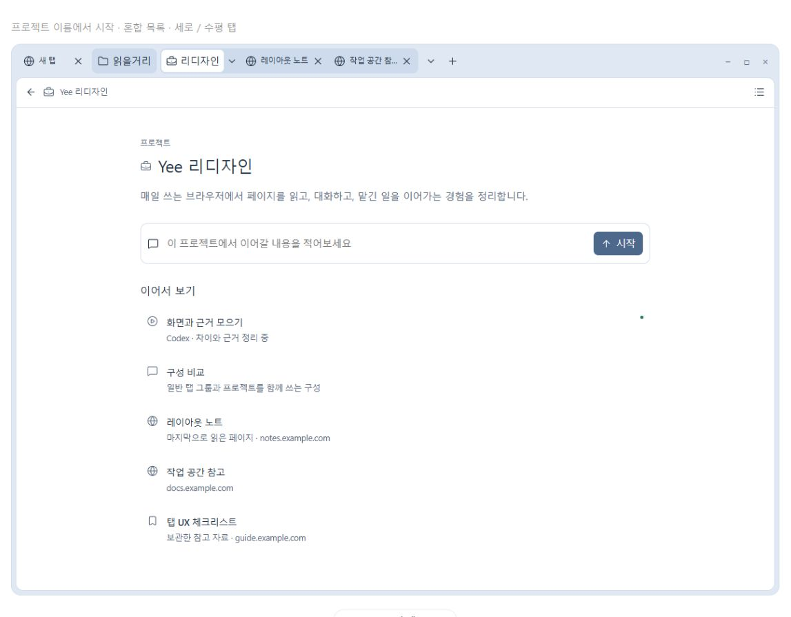
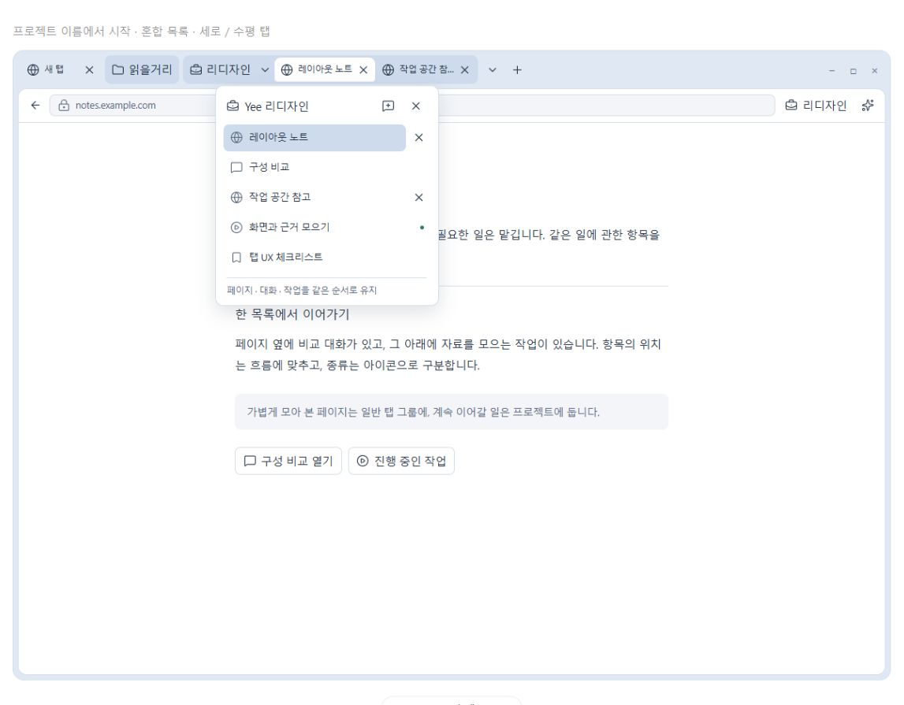
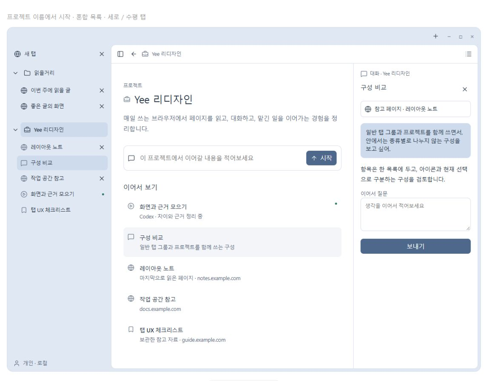

# 프로젝트 탐색 UX 핸드오프

프로젝트 탐색의 UX 방향과 남은 provider 작업을 다룬다.
프로젝트·페이지 참조 저장, 창별 native 탭 연결, 세로 목록·수평 선택기,
허브 왕복과 세션 UUID 복원의 책임과 저장 계약은
[상세 구현 계획](project-navigation-implementation-plan.md)의 8절과
[프로젝트 소유자 문서](../browser/projects/README.md)를 따른다.

## 바로 이어갈 작업

대화·작업 provider의 저장 계약과 혼합 항목의 실제 실행·기록 연결이 남아 있다.
플랫폼별 검증에서는 macOS·Linux의 실제 창과 macOS 설치 앱에서 프로젝트 탐색·탭 연결·
재실행 복원을 확인한다. [구현 후 검증](#구현-후-검증)을 따른다.

후속 작업을 시작할 때는 이 문서와 [AGENTS.md](../AGENTS.md),
[CONTRIBUTING.md](../CONTRIBUTING.md)를 읽는다. 이 인계 자체가 예약 슬롯 활성화나
AI 실행 기능의 구현을 모두 승인하는 것은 아니다.

## 작업 체크아웃

프로젝트 탐색 구현이 포함된 `pilot`에서 작업한다. `git worktree list`로 작업 위치를
확인하고 기존 변경을 보존한다. 깨끗한 작업 트리는 `git pull --ff-only`로 갱신한다.

## 자료 열기

- [캡처와 시안 안내](../experiments/shell-prototype/project-navigation/README.md)
- [실행 가능한 시안](../experiments/shell-prototype/project-navigation/index.html)
- [대화에서 사용한 원본 조각](../experiments/shell-prototype/project-navigation/ux-fragment.html)
- [출처·해시·검증 범위](../experiments/shell-prototype/project-navigation/manifest.json)

저장소의 파일만으로 참고할 수 있게 보관했다. 시안을 열고 하단의 ‘수평 탭’과 ‘세로 탭’을
전환한다. 로컬 서버를 사용하는 방법은 시안 안내에 있다. 캡처와 예시 데이터는 HTML 시연이며
현재 Yee 앱의 화면이나 네이티브 검증 결과가 아니다.

## 유지할 UX 방향

사용자는 매일 직접 쓰는 브라우저를 우선하며, 외부 에이전트 실행과 브라우저 안의 AI 작업도
함께 필요하다고 했다. 다음 흐름에 대해 ‘전반적으로 좋은 것 같다’, ‘흐름 좋은 것 같다’고 했다.
세부 저장 정책, 기본 탭 방향이나 시안의 모든 예시 기능까지 확정한 것은 아니다.

| 항목 | 이어갈 방향 |
| --- | --- |
| 탐색 계층 | 일반 탭, 일반 탭 그룹, 프로젝트가 함께 존재한다. 모든 탭에 프로젝트를 강제하지 않는다. |
| 프로젝트 내부 | 페이지·대화·작업·보관한 자료를 한 목록에 섞고 종류를 아이콘으로 구분한다. 필수 유형별 섹션을 추가하지 않는다. |
| 프로젝트 허브 | 세로에서는 프로젝트 오른쪽 허브 버튼, 수평에서는 상단 프로젝트 이름으로 기본 화면을 연다. 별도 허브 하위 항목은 두지 않는다. |
| 목록 펼치기 | 세로에서는 프로젝트 행 전체가 일반 그룹처럼 목록을 접고 펼친다. 왼쪽 아이콘은 hover/focus 때 회전 화살표로 바뀐다. 수평에서는 옆 화살표가 혼합 목록을 연다. 가운데 내용은 유지한다. |
| 세로 탭 | 왼쪽 탐색 목록을 유지한다. 페이지·대화·작업에 직접 접근한다. |
| 수평 탭 | 왼쪽 사이드바와 아이콘 줄을 없애고 본문을 넓게 쓴다. 상단 프로젝트 이름과 목록 버튼으로 접근한다. |
| 수평 웹탭 | 실제 열린 웹페이지를 표시한다. 대화·작업·허브를 가짜 웹탭으로 추가하지 않는 것이 현재 기본안이다. |
| 허브의 내용 | 프로젝트 설명, 새 대화 입력, 페이지·대화·작업을 섞은 이어보기 목록을 둔다. |
| 보조 패널 | 대화·작업은 현재 웹페이지 또는 허브 옆에서 연다. 작업을 시작했다는 이유로 읽던 페이지에서 강제로 이동하지 않는다. |
| 브랜드 표시 | 창 상단의 장식용 `yee` 표시는 제거한다. 예시 프로젝트 이름 ‘Yee 리디자인’과 제품·설치 이름 변경은 별개다. |

초기의 유형별 탭/대화/작업 섹션, 프로젝트 허브 하위 메뉴, 수평 탭의 왼쪽 아이콘 줄은
최신 흐름에서 제외했다. 예전 시안이나 취향 기록으로 되돌리지 않는다.
세로 화면을 마지막으로 열어 보았다는 이유만으로 세로 탭을 유일한 기본값으로 확정하지 않는다.

## 화면과 확인할 동선

### 세로 탭과 허브

왼쪽에는 일반 탭·일반 그룹·프로젝트와 프로젝트의 혼합 항목이 함께 보인다.
프로젝트 행 전체는 목록을 접고 펼친다. 오른쪽 허브 버튼은 가운데 허브를 열며, 더보기는 프로젝트 이름 변경·삭제 메뉴를 연다. 보조 버튼은 폴딩으로 전파되지 않고 허브 진입·복귀도 접힘 상태를 유지한다.

### 수평 탭과 허브

상단의 ‘리디자인’은 예시 프로젝트 이름의 짧은 표시다. 누르면 같은 허브를 연다.
왼쪽 영역은 없으며 일반 탭과 ‘읽을거리’ 일반 그룹이 프로젝트와 함께 남는다.

### 수평 탭의 혼합 목록

페이지를 보면서 프로젝트 옆 화살표를 누른 상태다. 페이지·대화·작업이 한 목록에 섞인다.
목록 상단의 프로젝트 제목도 허브로 연결한다. 일반 그룹 이름은 기존 그룹 접기 동작을 유지한다.

### 허브 옆에서 대화 이어가기

대화를 골라도 허브와 왼쪽 탐색을 유지한다. 웹페이지에서 대화를 골랐을 때는 읽던 페이지를
유지한다. 현재 대화의 참고 자료를 다른 탭을 열었다는 이유로 자동 교체하지 않는다.

## 시안에서만 확인된 동작

- 프로젝트 이름으로 허브에 들어가고 실제 페이지 예시를 열었다가 다시 돌아온다.
- 프로젝트 화살표로 혼합 목록을 펼쳐도 현재 내용은 유지된다.
- 대화·작업을 허브 또는 페이지 옆에 연다.
- 프로젝트 페이지를 닫으면 보관한 자료로 남고 명시적으로 다시 열 수 있다.
- 일반 새 탭은 프로젝트 밖에 생긴다.
- 허브 입력으로 예시 대화를 시작할 수 있으며 현재 페이지·프로젝트 전체 자료를 자동 첨부하지 않는다.

시안의 저장은 일부 UI 상태만 기억한다. 동적으로 만든 대화 본문·프로젝트·실제 세션 전체의
영속 저장이나 재시작 복원을 구현한 것이 아니다. 닫은 페이지를 자료로 보존하는 정책도
네이티브 구현 전에 범위와 삭제·보관 동작을 구체화해야 한다.

## 현재 코드에서 확인한 출발점

다음 파일은 탐색 진입점이다. 새 기능이 이미 구현되어 있다는 뜻은 아니다.

| 근거 | 의미 |
| --- | --- |
| [Sidebar 소유권](sidebar/ownership.md), [배치](sidebar/layout.md) | 탭·그룹은 Chromium 소유, Yee는 표현을 소유한다. Chat/Agent History는 예약 범위다. |
| [Browser Surface 배치](../browser/ui/browser_surface_layout.h) | 수평·세로 모드, 실제 본문과 Side Panel의 배치 기반이 있다. |
| [수평 탭 표현](../browser/ui/horizontal_tab_presentation.h), [그룹 표현](../browser/ui/tab_group_presentation.h) | 기존 native 탭·그룹의 표시를 확장할 진입점이다. |
| [공통 UI 치수](../browser/ui/sidebar_metrics.h) | `yee::kSidebarMetrics`가 시각 계약이다. 시안 CSS 숫자를 별도로 복사하지 않는다. |
| [Agent 탭 상태](../browser/ui/agent_tab_activity.h) | 탭의 working/needs-input 표시는 Agent Task 자체나 사용자 그룹과 구분되어 있다. |
| [Agent 구조](agent-browser-architecture.md) | 현재 외부 MCP adapter와 Native bridge를 사용한다. 앱 내부 MCP transport나 완전한 작업 이력이 구현되었다고 가정하지 않는다. |
| [Footer](sidebar/footer.md) | Account/Tenant/Workspace의 맥락은 프로젝트와 자동으로 같은 개념이 되지 않는다. |
| [제품 소스와 overlay](project-structure.md) | 제품 소스·Chromium 연결 패치·생성 빌드의 소유권을 따른다. |

소유권 경계는 다음과 같이 유지한다.

| 책임 | 소유자와 소비자 | 넘지 않을 경계 |
| --- | --- | --- |
| 실제 탭·그룹·페이지 수명 | Chromium의 `TabStripModel`, `TabView`, `WebContents`; Yee 연결부가 기존 명령 호출 | 프로젝트 기능을 위해 두 번째 탭 모델을 만들지 않는다. |
| 프로젝트·항목 참조·보관 정보 | 새 프로젝트 데이터 책임. 실제 소비자와 저장 수명을 조사한 뒤 `browser/` 안의 위치를 확정 | View/색상/DOM에 저장 정책을 넣지 않는다. runtime 탭 포인터나 일시 ID를 영속 ID로 저장하지 않는다. |
| 현재 허브/페이지와 복귀 위치 | 창 단위 탐색 상태; 세로·수평 표현이 같은 상태 소비 | 방향마다 별도 프로젝트 저장소나 실제 탭 복사본을 두지 않는다. |
| 화면·입력·접근성 | `browser/ui/`의 Yee 제품 UI, Chromium 원본에는 작은 연결만 | 제품 정책을 `TabStripModel`이나 Chromium layout 상수에 넣지 않는다. |
| 대화·작업 실행과 이력 | 해당 provider/실행 책임, 프로젝트는 그 기록의 참조 소비 | 탭 활동 표시를 작업 저장소로 사용하지 않는다. `components/tasks/`의 sequence 소유 어댑터를 Agent Task 모델로 오인하지 않는다. |

예를 들어 `TabStripModel`에 대화 목록·프로젝트 저장 정책을 추가하거나, 동일한 URL을
전역에서 중복 제거해 사용자의 정상적인 여러 탭을 합치는 구현은 이 경계를 위반한다.
프로젝트 목록의 참조 순서와 native 웹탭 순서의 관계도 별도로 정의해야 한다.

## 최초 계획에서 다룬 결정과 후속 범위

아래는 최초 설계에서 검토한 항목이다. 첫 native 구현의 실제 계약은 상세 계획 8절과
현재 코드를 따른다. provider·후속 제품 정책까지 구현된 것으로 간주하지 않는다.

1. **허브의 네이티브 호스팅.** 현재 웹페이지를 살아 있게 두면서 내부 기본 화면을 어디에
   표시할지, 주소·사이트 권한·뒤로가기·키보드 초점을 어떻게 표현할지 정한다. 허브 때문에
   작성 중인 폼을 탐색시키거나 실제 사이트의 주소로 허브를 오인하게 해서는 안 된다.
   새 웹탭을 만들지 않는 UX 기본안과 기존 native 탭 수명을 함께 만족시키는 설계가 필요하다.
2. **프로젝트와 그룹의 연결.** 일반 그룹을 프로젝트에 연결·해제하는 방법, 다중 창에서의
   소속과 이동, 프로젝트를 제거할 때 실제 탭·대화·자료에 미치는 영향을 정한다.
3. **저장과 복원.** 안정적인 프로젝트/항목 ID, 닫은 페이지의 보관 기준, 다시 열기 중복 방지,
   세션 복원 후 native 탭과의 재연결, 데이터 버전·실패 시 복구·시크릿 범위를 정한다.
   한 항목을 재열 때의 중복 방지와 같은 URL의 여러 정상 탭은 구분한다.
4. **목록 순서.** 수동 순서와 최근 활동의 관계, 페이지 이동·드래그와 mixed 항목 재배치,
   항목이 많을 때의 찾기·좁혀보기·가상화 필요성을 실제 사용량에 맞춰 정한다.
5. **대화·작업 provider.** 실재하는 기록·상태·중단·입력 요청의 계약과 프로젝트 연결을
   정의한다. 프로젝트 소속이 곧 전체 자료 AI 전송이나 사이트 조작 권한은 아니다.
6. **도입 범위.** 기본 탭 방향, 프로젝트 없는 사용자 경험, 기존 설정·Favorites·그룹 유지와
   점진 적용 방법을 정한다. 양쪽 방향은 계획과 검증에서 모두 다루되 기본값은 아직 미정이다.

## 단계별 구현 범위와 완료 조건

0~2단계의 페이지 탐색과 저장 연결은 첫 native 구현에 포함됐다. 아래 표는 단계별
완료 기준이며 플랫폼별 검수 통과나 3~4단계 provider 구현을 뜻하지 않는다.

| 단계 | 작업과 선행 조건 | 완료 조건 |
| --- | --- | --- |
| 0. 상세 계획 | 통합된 native UI 기반과 검수 범위를 확인하고 위 결정, 책임·파일 배치, 저장 계약, 테스트와 변경 단위를 정리 | mock 상태와 native 구현을 구분한 계획. 명세 충돌과 예약 범위를 명시하고 미해결 정책을 숨기지 않음 |
| 1. 첫 실제 흐름 | 단계 0의 저장·허브 호스팅 결정 후 프로젝트 생성/이름/탭 연결, 허브 왕복과 재시작 복원 구현 | 실제 탭 하나를 연결해 읽던 페이지·입력 내용을 잃지 않고 허브 왕복. 재시작 후 기록·탭 재연결이 중복 없이 복원됨 |
| 2. 탐색 목록 | 단계 1의 동일 데이터로 세로 혼합 목록과 수평 프로젝트 목록 연결, 일반 그룹·미소속 탭 유지 | 이름과 화살표 역할이 일관됨. 배치 전환·탭 이동·닫기·재열기·다중 창에서 일관된 상태. 수평에 왼쪽 영역이 생기지 않음 |
| 3. 대화 연결 | 실제 대화 provider와 저장 계약 후 허브 입력·대화 참조·패널 연결 | 현재 페이지 또는 허브를 유지하며 대화를 이어감. 참고 자료는 명시적이며 다른 탭으로 자동 교체되지 않음 |
| 4. 작업 연결 | 실제 작업 provider와 기존 권한 계약을 확인한 뒤 외부/내장 작업 상태·자료·중단·사용자 인계 연결 | 작업 상태가 native 탭·그룹 상태와 구분되고 시작 맥락에 남음. 새 작업 시작만으로 사용자 초점을 빼앗지 않음 |

새 디렉터리가 필요하면 [overlay 구조](project-structure.md)에 맞는 소스 매핑과 GN 연결까지
계획에 포함한다. 코드 배치를 먼저 임의로 확정하거나 UI 전체를 프로토타입 HTML로 대체하지 않는다.
기존 Chat/Agent History 슬롯과 새 프로젝트의 항목 참조를 구분하고, 예약 슬롯을 켜는 결정은
저장소 규칙과 사용자의 해당 구현 범위에 따라 확인한다.

## 구현 후 검증

- 프로젝트 저장/재연결/순서/닫기 정책은 해당 소유자의 의미 있는 단위 테스트로 검증한다.
- 실제 탭·그룹 이동, 취소 복원, 키보드 초점, Side Panel과 허브의 수명은 native UI 검사로 확인한다.
- [Sidebar](sidebar/README.md)와 [Header](header/README.md)의 관련 검사,
  [Browser Surface 단계별 gate](../AGENTS.md)를 변경 범위에 맞춰 선택한다.
  큰 통합 빌드를 매 수정마다 반복하지 않는다.
- 코드·문서를 독립된 새 맥락에서 검토하고, 발견 사항을 수정한 최종 상태를 다시 검토한다.
- 실제 UI 변경은 해당 빌드와 별도 검수 프로필의 새 프로세스에서 실제 탭으로 검증한다.
  그 실행 파일이나 검수 프로필을 사용하는 프로세스만 정상 종료하며, 설치된 릴리즈의
  실행 파일·프로필이 분리돼 있으면 계속 사용한다. 다른 창을 닫는 테스트 복구도 사용하지 않는다.
- 시안의 320px 반응형 검사는 네이티브 앱의 최소 창 폭이나 모바일 지원을 확정한 것이 아니다.

창별 프로젝트 UUID의 저장·재연결과 앱을 재시작한 뒤의 탭 그룹 복원은 각각 확인한다.
기본 모션 검사는 정상 속도로 실행한다. 중간 장면을 느리게 촬영한 결과는
해당 장면의 레이아웃을 검토하는 데 쓴다.

## 창별 페이지와 공통 조작

프로젝트 자료는 프로필에서 공유한다. 같은 자료가 다른 창에 열려 있어도 현재 창에는 별도의 native 탭을 연다. 현재 창에 이미 열린 인스턴스가 있으면 그 탭을 재사용한다. 열림 상태·제목·주소·선택·닫기·중클릭·탭 메뉴는 현재 창의 실제 탭을 따른다. 다른 창의 작성 내용이나 탐색 상태를 바꾸지 않는다.

세션 복원과 재열기 중복 방지는 창 안에서만 적용한다. 같은 자료가 이미 있는 창으로 탭을 이동하면 실제 두 탭을 보존하고, 이동한 탭은 일반 탭으로 표시한다. 자료 삭제는 모든 창의 참조를 해제하지만 실제 탭을 닫지 않는다.

허브 상단에는 프로젝트 이름과 전환만 남긴다. 실제 탭 선택과 기존 키보드 명령으로 페이지에 복귀한다. 키보드 진입은 프로젝트 이름에 초점을 두고, 상단 공간이 없으면 본문 조작으로 이동한다. 포인터 진입은 강제 포커스 링을 남기지 않는다.

프로젝트 페이지의 닫기는 일반 탭과 같은 native TabCloseButton을 사용한다. 허브와 사이드바의 보조 버튼은 공통 native 설정을 사용하고, 가로 배치에서는 버튼의 중앙 높이를 맞춘다. 기본·hover·선택·선택+hover·누름·비활성·키보드 포커스와 포인터 이탈을 실제 Yee에서 검수한다.

자료 정보 갱신은 허브와 Sidebar의 스크롤 위치를 유지하고, 다른 프로젝트로
전환한 허브는 처음부터 표시한다. 프로젝트 때문에 숨긴 native 행은 URL 드롭
대상에서 제외하며, 분할 행에 멤버 하나만 보이면 그 탭을 대상으로 한다.

프로젝트 탭 coordinator의 factory는 프로필 생성 전의 Chromium factory 등록 단계에서
준비한다. 등록만으로 프로젝트 서비스를 생성하지 않으며, 실제 프로필별 서비스의
생성·종료와 일반·비공개·게스트 프로필 구분은 기존 KeyedService 소유 규칙을 따른다.
