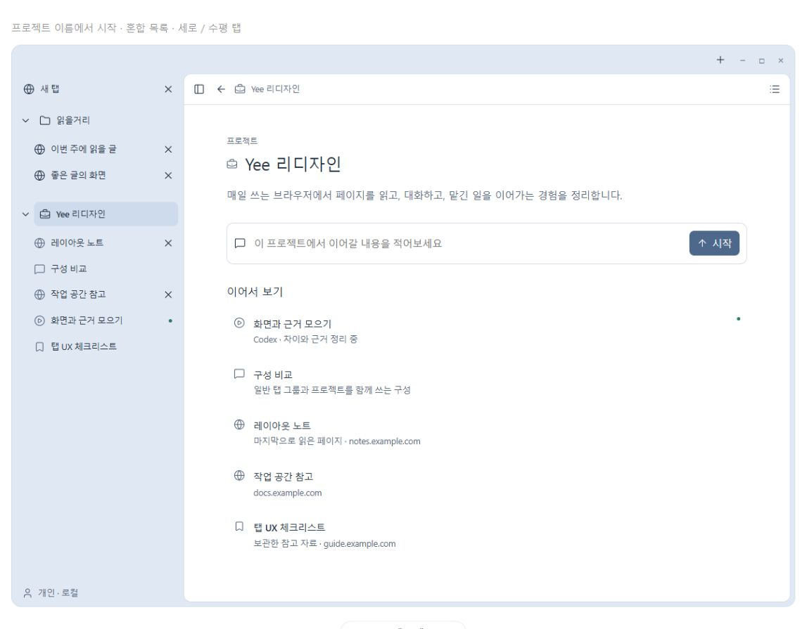
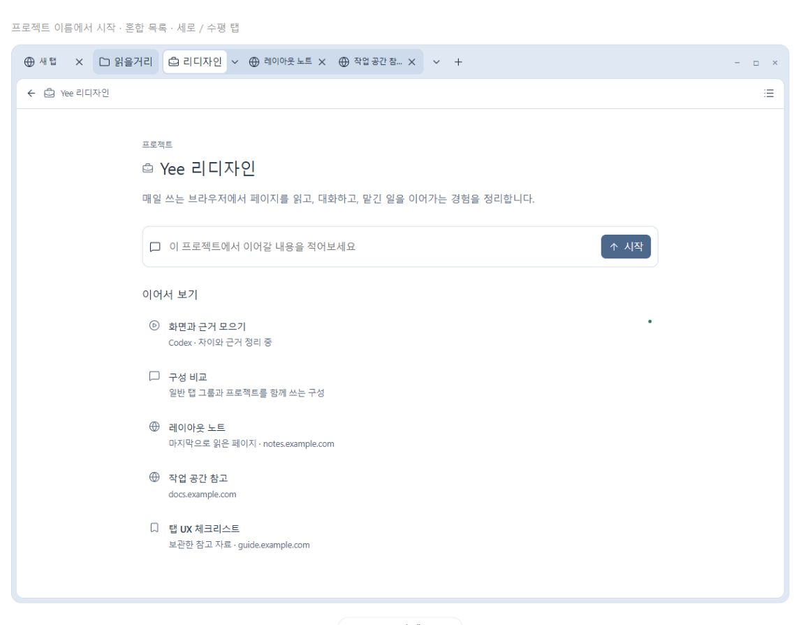
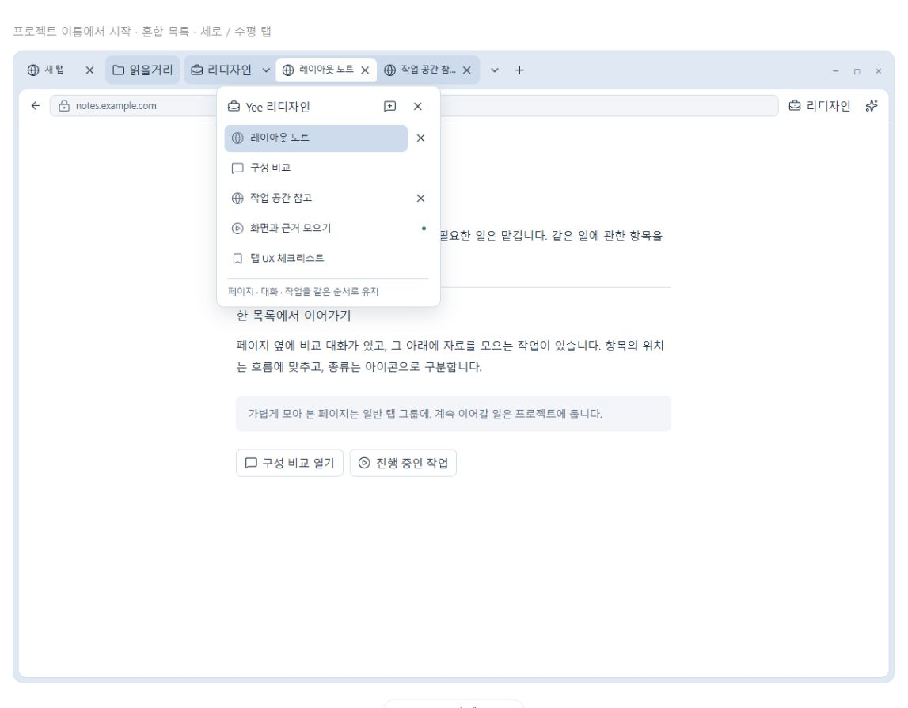
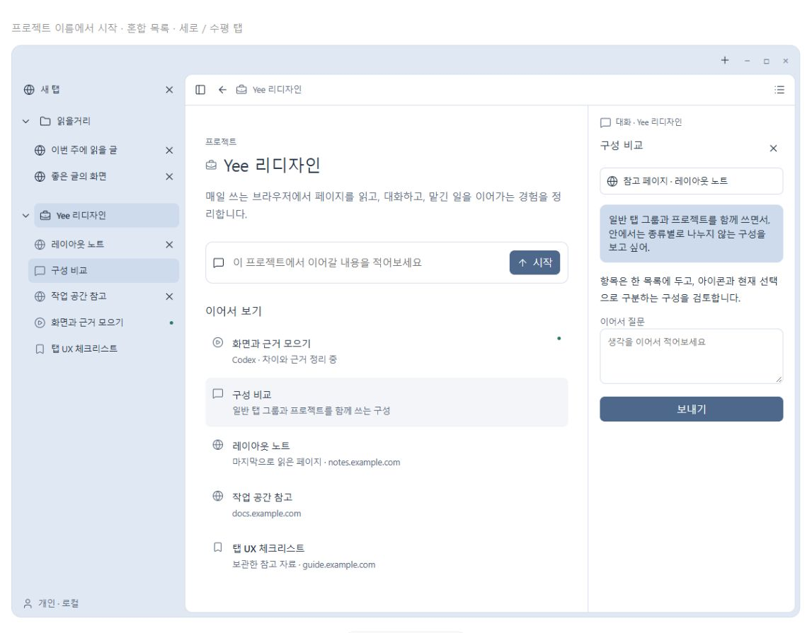

# 프로젝트 탐색 UX 핸드오프

2026-10-26 · 브랜치 `codex/project-navigation-handoff`

사용자가 긍정적으로 본 프로젝트 탐색 흐름을 다음 작업에서 이어가기 위한 인계다.
이번 브랜치는 문서, 시안 원본, 독립 실행용 시안과 캡처를 보관한다.
네이티브 기능 구현이나 제품 명세 변경을 완료한 브랜치가 아니다.

## 바로 이어갈 작업

**다음 산출물은 실제 코드에 근거한 상세 구현 계획이다.** 아래 기본 UX를 유지하고,
프로젝트 데이터의 소유자, 허브의 네이티브 호스팅, 저장·복원 규칙부터 결정한다.
첫 구현 범위는 다음 한 흐름을 완성하는 크기로 잡는다.

> 프로젝트 생성 → 실제 브라우저 탭 연결 → 허브 왕복 → 재시작 후 복원

후속 작업을 시작할 때는 이 문서와 [AGENTS.md](../AGENTS.md),
[CONTRIBUTING.md](../CONTRIBUTING.md)를 읽는다. 이 인계 자체가 예약 슬롯 활성화나
AI 실행 기능의 구현을 모두 승인하는 것은 아니다.

## 체크아웃과 기존 작업

| 항목 | 값 |
| --- | --- |
| 이 브랜치의 작업 폴더 | `F:/yee/worktrees/project-navigation-handoff` |
| 분기 기준 | `pilot`의 `efc3e425bd80a8db507b89430cc5f9824a527d9b` |
| 기존 작업 폴더 | `F:/yee/pilot-repo` |
| 기존 미커밋 변경 | 13개 파일. 이 브랜치에 포함하지 않고 원래 폴더에 보존 |

기존 변경에는 Browser Surface, 주소창, 관련 테스트·명세와 Chromium 연결 패치가 있다.
[기준 상태와 파일 해시](../experiments/shell-prototype/project-navigation/baseline-working-tree.json)를
먼저 확인한다. 해시는 변경 내용을 복원하는 백업 패치가 아니다. 다른 환경에서 이어가려면
해당 기존 작업을 별도로 전달받아야 한다. 구현 전에 기존 작업의 통합 여부와 실제 기반을
확인하고, 기존 변경을 덮어쓰거나 현재 브랜치에 무작정 합치지 않는다.

이 브랜치는 위 별도 폴더에 이미 체크아웃되어 있다. 기존 `pilot` 폴더를 강제로 전환하지
말고 새 작업 폴더를 사용한다. 위치는 어느 체크아웃에서든 `git worktree list`로 확인할 수 있다.

## 자료 열기

- [캡처와 시안 안내](../experiments/shell-prototype/project-navigation/README.md)
- [실행 가능한 시안](../experiments/shell-prototype/project-navigation/index.html)
- [대화에서 사용한 원본 조각](../experiments/shell-prototype/project-navigation/ux-fragment.html)
- [출처·해시·검증 범위](../experiments/shell-prototype/project-navigation/manifest.json)

저장소의 파일만으로 참고할 수 있게 보관했다. 시안을 열고 하단의 ‘수평 탭’과 ‘세로 탭’을
전환한다. 로컬 서버를 사용하는 방법은 시안 안내에 있다. 캡처와 예시 데이터는 HTML 시연이며
현재 Yee 앱의 화면이나 네이티브 검증 결과가 아니다.

## 유지할 UX 방향

사용자는 매일 직접 쓰는 브라우저를 우선하며, 외부 에이전트 실행과 브라우저 안의 AI 작업도
함께 필요하다고 했다. 다음 흐름에 대해 ‘전반적으로 좋은 것 같다’, ‘흐름 좋은 것 같다’고 했다.
세부 저장 정책, 기본 탭 방향이나 시안의 모든 예시 기능까지 확정한 것은 아니다.

| 항목 | 이어갈 방향 |
| --- | --- |
| 탐색 계층 | 일반 탭, 일반 탭 그룹, 프로젝트가 함께 존재한다. 모든 탭에 프로젝트를 강제하지 않는다. |
| 프로젝트 내부 | 페이지·대화·작업·보관한 자료를 한 목록에 섞고 종류를 아이콘으로 구분한다. 필수 유형별 섹션을 추가하지 않는다. |
| 프로젝트 허브 | 프로젝트 이름을 누르면 해당 프로젝트의 기본 화면을 연다. 별도 ‘허브’ 하위 항목이나 필수 중간 단계를 만들지 않는다. |
| 목록 펼치기 | 세로에서는 프로젝트 옆 화살표가 목록을 접고 펼친다. 수평에서는 옆 화살표가 혼합 목록을 연다. 이 동작이 가운데 내용을 바꾸지 않는다. |
| 세로 탭 | 왼쪽 탐색 목록을 유지한다. 페이지·대화·작업에 직접 접근한다. |
| 수평 탭 | 왼쪽 사이드바와 아이콘 줄을 없애고 본문을 넓게 쓴다. 상단 프로젝트 이름과 목록 버튼으로 접근한다. |
| 수평 웹탭 | 실제 열린 웹페이지를 표시한다. 대화·작업·허브를 가짜 웹탭으로 추가하지 않는 것이 현재 기본안이다. |
| 허브의 내용 | 프로젝트 설명, 새 대화 입력, 페이지·대화·작업을 섞은 이어보기 목록을 둔다. |
| 보조 패널 | 대화·작업은 현재 웹페이지 또는 허브 옆에서 연다. 작업을 시작했다는 이유로 읽던 페이지에서 강제로 이동하지 않는다. |
| 브랜드 표시 | 창 상단의 장식용 `yee` 표시는 제거한다. 예시 프로젝트 이름 ‘Yee 리디자인’과 제품·설치 이름 변경은 별개다. |

초기의 유형별 탭/대화/작업 섹션, 프로젝트 허브 하위 메뉴, 수평 탭의 왼쪽 아이콘 줄은
최신 흐름에서 제외했다. 예전 시안이나 취향 기록으로 되돌리지 않는다.
세로 화면을 마지막으로 열어 보았다는 이유만으로 세로 탭을 유일한 기본값으로 확정하지 않는다.

## 화면과 확인할 동선

### 세로 탭과 허브

왼쪽에는 일반 탭·일반 그룹·프로젝트와 프로젝트의 혼합 항목이 함께 보인다.
프로젝트 이름을 누르면 가운데가 허브가 되고, 화살표는 목록만 접는다.

### 수평 탭과 허브

상단의 ‘리디자인’은 예시 프로젝트 이름의 짧은 표시다. 누르면 같은 허브를 연다.
왼쪽 영역은 없으며 일반 탭과 ‘읽을거리’ 일반 그룹이 프로젝트와 함께 남는다.

### 수평 탭의 혼합 목록

페이지를 보면서 프로젝트 옆 화살표를 누른 상태다. 페이지·대화·작업이 한 목록에 섞인다.
목록 상단의 프로젝트 제목도 허브로 연결한다. 일반 그룹 이름은 기존 그룹 접기 동작을 유지한다.

### 허브 옆에서 대화 이어가기

대화를 골라도 허브와 왼쪽 탐색을 유지한다. 웹페이지에서 대화를 골랐을 때는 읽던 페이지를
유지한다. 현재 대화의 참고 자료를 다른 탭을 열었다는 이유로 자동 교체하지 않는다.

## 시안에서만 확인된 동작

- 프로젝트 이름으로 허브에 들어가고 실제 페이지 예시를 열었다가 다시 돌아온다.
- 프로젝트 화살표로 혼합 목록을 펼쳐도 현재 내용은 유지된다.
- 대화·작업을 허브 또는 페이지 옆에 연다.
- 프로젝트 페이지를 닫으면 보관한 자료로 남고 명시적으로 다시 열 수 있다.
- 일반 새 탭은 프로젝트 밖에 생긴다.
- 허브 입력으로 예시 대화를 시작할 수 있으며 현재 페이지·프로젝트 전체 자료를 자동 첨부하지 않는다.

시안의 저장은 일부 UI 상태만 기억한다. 동적으로 만든 대화 본문·프로젝트·실제 세션 전체의
영속 저장이나 재시작 복원을 구현한 것이 아니다. 닫은 페이지를 자료로 보존하는 정책도
네이티브 구현 전에 범위와 삭제·보관 동작을 구체화해야 한다.

## 현재 코드에서 확인한 출발점

다음 파일은 탐색 진입점이다. 새 기능이 이미 구현되어 있다는 뜻은 아니다.

| 근거 | 의미 |
| --- | --- |
| [Sidebar 소유권](sidebar/ownership.md), [배치](sidebar/layout.md) | 탭·그룹은 Chromium 소유, Yee는 표현을 소유한다. Chat/Agent History는 예약 범위다. |
| [Browser Surface 배치](../browser/ui/browser_surface_layout.h) | 수평·세로 모드, 실제 본문과 Side Panel의 배치 기반이 있다. |
| [수평 탭 표현](../browser/ui/horizontal_tab_presentation.h), [그룹 표현](../browser/ui/tab_group_presentation.h) | 기존 native 탭·그룹의 표시를 확장할 진입점이다. |
| [공통 UI 치수](../browser/ui/yee_ui.h) | `yee::kSidebarMetrics`가 시각 계약이다. 시안 CSS 숫자를 별도로 복사하지 않는다. |
| [Agent 탭 상태](../browser/ui/agent_tab_activity.h) | 탭의 working/needs-input 표시는 Agent Task 자체나 사용자 그룹과 구분되어 있다. |
| [Agent 구조](agent-browser-architecture.md) | 현재 외부 MCP adapter와 Native bridge를 사용한다. 앱 내부 MCP transport나 완전한 작업 이력이 구현되었다고 가정하지 않는다. |
| [Footer](sidebar/footer.md) | Account/Tenant/Workspace의 맥락은 프로젝트와 자동으로 같은 개념이 되지 않는다. |
| [제품 소스와 overlay](project-structure.md) | 제품 소스·Chromium 연결 패치·생성 빌드의 소유권을 따른다. |

소유권 경계는 다음과 같이 유지한다.

| 책임 | 소유자와 소비자 | 넘지 않을 경계 |
| --- | --- | --- |
| 실제 탭·그룹·페이지 수명 | Chromium의 `TabStripModel`, `TabView`, `WebContents`; Yee 연결부가 기존 명령 호출 | 프로젝트 기능을 위해 두 번째 탭 모델을 만들지 않는다. |
| 프로젝트·항목 참조·보관 정보 | 새 프로젝트 데이터 책임. 실제 소비자와 저장 수명을 조사한 뒤 `browser/` 안의 위치를 확정 | View/색상/DOM에 저장 정책을 넣지 않는다. runtime 탭 포인터나 일시 ID를 영속 ID로 저장하지 않는다. |
| 현재 허브/페이지와 복귀 위치 | 창 단위 탐색 상태; 세로·수평 표현이 같은 상태 소비 | 방향마다 별도 프로젝트 저장소나 실제 탭 복사본을 두지 않는다. |
| 화면·입력·접근성 | `browser/ui/`의 Yee 제품 UI, Chromium 원본에는 작은 연결만 | 제품 정책을 `TabStripModel`이나 Chromium layout 상수에 넣지 않는다. |
| 대화·작업 실행과 이력 | 해당 provider/실행 책임, 프로젝트는 그 기록의 참조 소비 | 탭 활동 표시를 작업 저장소로 사용하지 않는다. `components/tasks/`의 sequence 소유 어댑터를 Agent Task 모델로 오인하지 않는다. |

예를 들어 `TabStripModel`에 대화 목록·프로젝트 저장 정책을 추가하거나, 동일한 URL을
전역에서 중복 제거해 사용자의 정상적인 여러 탭을 합치는 구현은 이 경계를 위반한다.
프로젝트 목록의 참조 순서와 native 웹탭 순서의 관계도 별도로 정의해야 한다.

## 구현 전에 구체화할 결정

1. **허브의 네이티브 호스팅.** 현재 웹페이지를 살아 있게 두면서 내부 기본 화면을 어디에
   표시할지, 주소·사이트 권한·뒤로가기·키보드 초점을 어떻게 표현할지 정한다. 허브 때문에
   작성 중인 폼을 탐색시키거나 실제 사이트의 주소로 허브를 오인하게 해서는 안 된다.
   새 웹탭을 만들지 않는 UX 기본안과 기존 native 탭 수명을 함께 만족시키는 설계가 필요하다.
2. **프로젝트와 그룹의 연결.** 일반 그룹을 프로젝트에 연결·해제하는 방법, 다중 창에서의
   소속과 이동, 프로젝트를 제거할 때 실제 탭·대화·자료에 미치는 영향을 정한다.
3. **저장과 복원.** 안정적인 프로젝트/항목 ID, 닫은 페이지의 보관 기준, 다시 열기 중복 방지,
   세션 복원 후 native 탭과의 재연결, 데이터 버전·실패 시 복구·시크릿 범위를 정한다.
   한 항목을 재열 때의 중복 방지와 같은 URL의 여러 정상 탭은 구분한다.
4. **목록 순서.** 수동 순서와 최근 활동의 관계, 페이지 이동·드래그와 mixed 항목 재배치,
   항목이 많을 때의 찾기·좁혀보기·가상화 필요성을 실제 사용량에 맞춰 정한다.
5. **대화·작업 provider.** 실재하는 기록·상태·중단·입력 요청의 계약과 프로젝트 연결을
   정의한다. 프로젝트 소속이 곧 전체 자료 AI 전송이나 사이트 조작 권한은 아니다.
6. **도입 범위.** 기본 탭 방향, 프로젝트 없는 사용자 경험, 기존 설정·Favorites·그룹 유지와
   점진 적용 방법을 정한다. 양쪽 방향은 계획과 검증에서 모두 다루되 기본값은 아직 미정이다.

## 권장 구현 순서와 완료 조건

| 단계 | 작업과 선행 조건 | 완료 조건 |
| --- | --- | --- |
| 0. 상세 계획 | 기존 미커밋 작업과 기반을 확인하고 위 결정, 책임·파일 배치, 저장 계약, 테스트와 변경 단위를 정리 | mock 상태와 native 구현을 구분한 계획. 명세 충돌과 예약 범위를 명시하고 미해결 정책을 숨기지 않음 |
| 1. 첫 실제 흐름 | 단계 0의 저장·허브 호스팅 결정 후 프로젝트 생성/이름/탭 연결, 허브 왕복과 재시작 복원 구현 | 실제 탭 하나를 연결해 읽던 페이지·입력 내용을 잃지 않고 허브 왕복. 재시작 후 기록·탭 재연결이 중복 없이 복원됨 |
| 2. 탐색 목록 | 단계 1의 동일 데이터로 세로 혼합 목록과 수평 프로젝트 목록 연결, 일반 그룹·미소속 탭 유지 | 이름과 화살표 역할이 일관됨. 배치 전환·탭 이동·닫기·재열기·다중 창에서 일관된 상태. 수평에 왼쪽 영역이 생기지 않음 |
| 3. 대화 연결 | 실제 대화 provider와 저장 계약 후 허브 입력·대화 참조·패널 연결 | 현재 페이지 또는 허브를 유지하며 대화를 이어감. 참고 자료는 명시적이며 다른 탭으로 자동 교체되지 않음 |
| 4. 작업 연결 | 실제 작업 provider와 기존 권한 계약을 확인한 뒤 외부/내장 작업 상태·자료·중단·사용자 인계 연결 | 작업 상태가 native 탭·그룹 상태와 구분되고 시작 맥락에 남음. 새 작업 시작만으로 사용자 초점을 빼앗지 않음 |

새 디렉터리가 필요하면 [overlay 구조](project-structure.md)에 맞는 소스 매핑과 GN 연결까지
계획에 포함한다. 코드 배치를 먼저 임의로 확정하거나 UI 전체를 프로토타입 HTML로 대체하지 않는다.
기존 Chat/Agent History 슬롯과 새 프로젝트의 항목 참조를 구분하고, 예약 슬롯을 켜는 결정은
저장소 규칙과 사용자의 해당 구현 범위에 따라 확인한다.

## 구현 후 검증

- 프로젝트 저장/재연결/순서/닫기 정책은 해당 소유자의 의미 있는 단위 테스트로 검증한다.
- 실제 탭·그룹 이동, 취소 복원, 키보드 초점, Side Panel과 허브의 수명은 native UI 검사로 확인한다.
- [Sidebar](sidebar/README.md)와 [Header](header/README.md)의 관련 검사,
  [Browser Surface 단계별 gate](../AGENTS.md)를 변경 범위에 맞춰 선택한다.
  큰 통합 빌드를 매 수정마다 반복하지 않는다.
- 코드·문서를 독립된 새 맥락에서 검토하고, 발견 사항을 수정한 최종 상태를 다시 검토한다.
- 실제 UI 변경은 해당 빌드 후 새 Yee 프로세스에서 실제 탭으로 검증한다. 정상 종료를 먼저
  요청하고, 종료가 안 된 프로세스를 임의 강제 종료하지 않는다. 개인 프로필과 테스트 프로필을 구분한다.
- 시안의 320px 반응형 검사는 네이티브 앱의 최소 창 폭이나 모바일 지원을 확정한 것이 아니다.

이번 인계에서는 export된 시안을 열고 캡처의 동선을 확인했다. Chromium 빌드, 실제 Yee 앱,
실제 영속 저장·재시작 복원, AI 실행·provider 연결은 검증하지 않았다.

## 다음 대화에 전달할 문장

> `F:/yee/worktrees/project-navigation-handoff`의 `codex/project-navigation-handoff` 브랜치에서
> `docs/project-navigation-handoff.md`와 저장소 작업 규칙을 읽고 이어가줘. 캡처의 기본 UX를
> 유지하면서 실제 코드에 근거한 상세 구현 계획부터 작성해줘. 먼저 기존 `pilot`의 미커밋 작업과
> 기반을 확인하고, 프로젝트 저장·탭 재연결·허브의 native 호스팅을 구체화해줘. 첫 구현 목표는
> 프로젝트 생성 → 실제 탭 연결 → 허브 왕복 → 재시작 복원이야.
